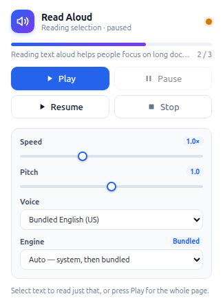
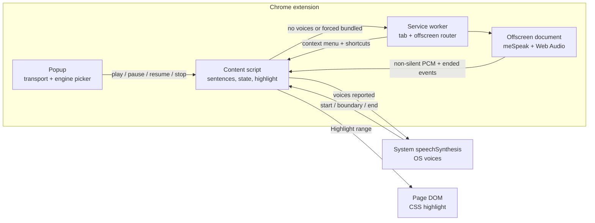

# Read Aloud — text to speech Chrome extension

A Manifest V3 Chrome extension that reads the selected text, or the whole page, with the
browser's system voices and falls back to a bundled offline voice when the browser reports no
system voices. No build step to load it, no external service, and no download at read time.




## What it does

- Reads the current selection, or the whole page when nothing is selected.
- Play, pause, resume and stop from the toolbar popup.
- Speed (0.5×–2×), pitch (0–2), voice and engine pickers saved in `chrome.storage.local`.
- **System voices by default.** When `speechSynthesis.getVoices()` is empty, it uses the bundled
  meSpeak/eSpeak voice, which ships inside the extension (~1.9 MB of assets) and synthesizes locally.
- The popup shows which engine is active: **System** or **Bundled**, next to the engine picker.
- Highlights the sentence being spoken without modifying the page markup.
- Keyboard shortcuts and a right-click **Read aloud** / **Stop reading** menu.
- Chunks very long sentences (240 characters) so playback stays responsive.

## Install unpacked

1. Open `chrome://extensions` in Chrome or any Chromium browser.
2. Turn on **Developer mode** (top right).
3. Click **Load unpacked** and pick this folder (the one containing `manifest.json`).
4. Pin **Read Aloud** to the toolbar.
5. Reload any tab you opened before installing, so the content script is present.

Chrome 116 or newer is required (CSS Custom Highlight API plus `chrome.runtime.getContexts`).

## Use

- Select some text and press **Play** to read only that. Press **Play** with nothing selected to
  read the page from the top.
- **Pause** stops the voice and keeps the highlight on the current sentence. **Resume** continues
  from the last spoken word (system) or audio position (bundled), and **Stop** clears playback and
  the highlight.
- Speed, pitch, voice and engine changes apply from the next sentence and persist between sessions.
- **Engine** offers `Auto — system, then bundled`, `System voices`, and `Bundled offline (eSpeak)`.
  Auto is the default. The badge on the right shows what the next reading will actually use.
- Shortcuts: `Ctrl+Shift+Y` reads, `Ctrl+Shift+U` stops. Rebind them at
  `chrome://extensions/shortcuts`.
- Right-click a page or a selection and choose **Read aloud** (or **Stop reading**).

## How it works



The popup and service worker message the content script; the content script owns playback state,
sentence progress and highlighting. For system voices it speaks one `SpeechSynthesisUtterance` per
sentence. For the bundled engine it sends each sentence to an offscreen document, which synthesizes
a WAV with meSpeak, decodes it with Web Audio, and reports when playback ends. Nothing leaves the
machine.

**Highlighting** uses `CSS.highlights` with the `::highlight(tts-extension-reading)` rule from
`src/content.css`. A `Range` is built from source-text offsets, so the page DOM is untouched and
`Ctrl+Z`, React, and other scripts never see highlight wrappers.

**Pause is cancel-and-remember** for both engines. Chrome's `speechSynthesis.pause()` did nothing
with Linux system voices in testing, so the extension cancels the current utterance and remembers
the last word boundary. For the bundled engine it stops the audio source and remembers the exact
audio offset, then starts a new source there on resume. This behaves the same on every platform.

The sentence splitter handles common abbreviations (`Dr.`, `e.g.`, `U.S.`), decimals, closing
quotes, and paragraph breaks. It returns offsets into the collected text, which keeps the
highlight aligned even when sentences span inline elements.

## The bundled voice

`vendor/mespeak/` contains meSpeak 1.9.6 (a JavaScript port of eSpeak), its config, and the US
English voice. The bundle is built once with esbuild and committed:

```bash
npm run build:vendor   # only needed when upgrading the vendored engine
```

Total shipped size is about **1.9 MB** (bundle 1.2 MB, config 0.57 MB, voice 0.11 MB), well under
the 30 MB budget. The popup never downloads anything; the assets are fetched from the extension
package by the offscreen document.

The bundled voice is intentionally a fallback: it is a robotic 22 kHz formant synthesizer with one
US English voice, not a neural TTS model. System voices remain the default whenever Chrome reports
any.

## Permissions

| Permission | Why |
| --- | --- |
| `storage` | Save speed, pitch, voice and engine preference. |
| `scripting` | Inject the reader into tabs opened before install, and into tabs driven by commands. |
| `contextMenus` | Add the right-click menu items. |
| `activeTab` | Talk to the page the user is looking at. |
| `offscreen` | Run the bundled voice and Web Audio outside any tab. |
| `host_permissions: <all_urls>` | Read page text and show the highlight on any normal website. |

No page text leaves the machine. System voices come from the operating system; the fallback voice
runs in WebAssembly-free plain JavaScript inside the extension. There is no TTS server, API key,
analytics, or runtime download.

## Tests

```bash
npm install --include=dev
npm test
```

`npm test` runs the unit tests and then the Playwright suite. This is the command to use — `bun
test` enforces a 5-second timeout that the browser suite will exceed.

### Unit tests

`npm run test:unit` runs `tests/unit.test.mjs` with Node's built-in test runner. It loads
`src/sentence.js` in a VM (the same classic script the content script uses) and checks sentence
boundaries, abbreviations, decimals, quotes, paragraphs, trimming and long-sentence chunking.

### Browser tests

`npm run test:e2e` launches the unpacked extension in a real Chromium persistent context:

```js
chromium.launchPersistentContext(userDataDir, {
  executablePath: CHROME,
  headless: true,
  args: [
    `--disable-extensions-except=${ROOT}`,
    `--load-extension=${ROOT}`,
  ],
})
```

The test finds a Chromium build in `~/.cache/ms-playwright`, preferring the revision that the
installed Playwright expects. Override it with `TTS_CHROME=/path/to/chrome npm run test:e2e`.

Three browser tests run against a local fixture page served over HTTP:

1. **Deterministic playback contract (system engine).** A fake speech engine is injected into the
   extension's isolated world (the same world as the content script), recording every utterance and
   firing `start` / `boundary` / `end`. The test selects a paragraph, plays, and asserts the first
   utterance, engine state, popup progress and the exact highlighted sentence. It pauses, waits,
   and asserts no new utterance starts and the highlight is frozen. It resumes, checks the remaining
   text is spoken and the highlight moves on, then stops and checks everything is cleared. It also
   reads the whole page, changes and reloads speed/pitch/voice settings, verifies the shortcut
   commands are registered, verifies the context menu exists, and drives the same command handler
   the menu and shortcuts use.
2. **Bundled voice (no system voices).** Chromium reports zero voices, so the default `Auto`
   preference must choose the bundled engine. The test asserts the popup says **Bundled**, plays a
   sentence, and inspects the offscreen document: a real WAV of over 100 KB, a non-zero peak and
   mostly non-silent samples (real synthesis, not a stub). It waits for the audio to advance the
   highlight to the next sentence, pauses and checks the audio offset and highlight freeze, resumes
   and checks playback continues, then stops. Result: `test-results/bundled-voice.json`.
3. **Real system engine.** Forces the `System` preference and uses Chromium's real
   `speechSynthesis` with `--enable-speech-dispatcher`. It asserts speaking starts, pause stops it,
   resume restarts it, sentence progress continues, and stop silences it. Result:
   `test-results/real-speech.json`.

Screenshots `docs/popup-bundled.png`, `docs/popup.png` and `docs/highlight.png` are captured by the
tests, not mocked up.

### What the tests do not prove

No one can hear the audio in the headless test environment. **Audibility is unverified.** The
bundled test proves that the engine produced non-silent PCM and that real Web Audio playback
advanced, paused and resumed; the system test proves Chromium reported `speaking: true` and
advanced through sentences (speech-dispatcher with espeak-ng is installed here). Neither can prove
that sound reached a speaker at a usable volume.

## Known limitations

- Chrome/Chromium 116+ only (CSS Custom Highlight API and `chrome.runtime.getContexts`).
- Reads the first selection range when several ranges are selected.
- Cannot run on `chrome://` pages, the Chrome Web Store, or the built-in PDF viewer.
- The bundled voice is US English only and sounds like eSpeak. Pick a system voice or another
  engine for better quality.
- System voice lists on Linux speech-dispatcher installations can be huge; the picker caps them at
  300 entries.
- Sentence splitting is heuristic; unusual abbreviations or all-lowercase prose can split in an
  unexpected place.
- If no system voice starts within four seconds, the popup shows an error. Switching the engine to
  `Bundled offline` always works without system voices.

## Project layout

```text
manifest.json            Manifest V3, permissions, shortcuts, content scripts
icons/                   Toolbar and extensions-page icons
src/background.js        Context menus, shortcuts, offscreen router, tab targeting
src/content.js           Selection/page text, engine choice, playback, highlight
src/sentence.js          Sentence segmentation with source offsets
src/content.css          ::highlight() styling
src/offscreen.html/js    Bundled voice synthesis and Web Audio playback
src/popup.html/css/js    Toolbar UI, settings and active-engine badge
vendor/mespeak/          Committed meSpeak/eSpeak bundle, config, voice and GPL license
scripts/build-vendor.mjs Regenerates vendor/mespeak from the npm package
tests/unit.test.mjs      Sentence splitter tests
tests/extension.test.mjs Playwright browser tests + screenshots
test-page/index.html     Fixture article for the browser tests
docs/                    Screenshots captured by the tests
```

## License

GPL-3.0. The extension code is GPL-3.0 because it bundles meSpeak and eSpeak, which are GPL. See
`LICENSE` and `vendor/mespeak/LICENSE`.
