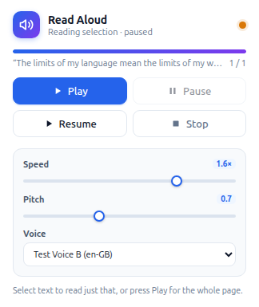
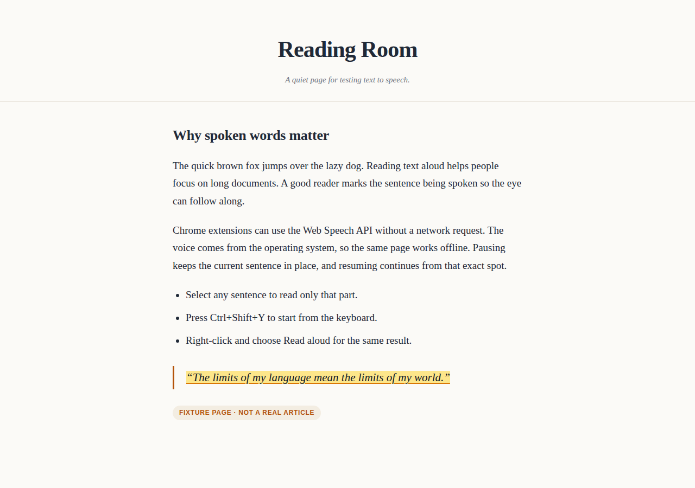
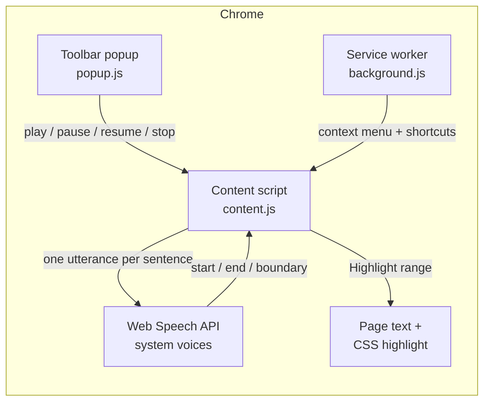

# Read Aloud — text to speech Chrome extension

A Manifest V3 Chrome extension that reads the selected text, or the whole page, using the
browser's built-in speech synthesis. No build step, no external service, no network calls.





## What it does

- Reads the current selection, or the whole page when nothing is selected.
- Play, pause, resume and stop from the toolbar popup.
- Speed (0.5×–2×), pitch (0–2) and voice pickers saved in `chrome.storage.local`.
- Highlights the sentence being spoken without modifying the page markup.
- Keyboard shortcuts and a right-click **Read aloud** / **Stop reading** menu.
- Chunks very long sentences (240 characters) so playback stays responsive.

## Install unpacked

1. Open `chrome://extensions` in Chrome or any Chromium browser.
2. Turn on **Developer mode** (top right).
3. Click **Load unpacked** and pick this folder (the one containing `manifest.json`).
4. Pin **Read Aloud** to the toolbar.
5. Reload any tab you opened before installing, so the content script is present.

Chrome 105 or newer is required (the CSS Custom Highlight API is used for highlighting).

## Use

- Select some text and press **Play** to read only that. Press **Play** with nothing selected to
  read the page from the top.
- **Pause** stops the voice and keeps the highlight on the current sentence. **Resume** continues
  from the last spoken word, and **Stop** clears playback and the highlight.
- Speed, pitch and voice changes apply from the next sentence and persist between sessions.
- Shortcuts: `Ctrl+Shift+Y` reads, `Ctrl+Shift+U` stops. Rebind them at
  `chrome://extensions/shortcuts`.
- Right-click a page or a selection and choose **Read aloud** (or **Stop reading**).

## How it works



The popup and service worker message the content script; the content script owns playback state
and talks to `window.speechSynthesis`. Everything is plain JavaScript loaded directly from
`src/` — there is no bundler.

**Highlighting** uses `CSS.highlights` with the `::highlight(tts-extension-reading)` rule from
`src/content.css`. A `Range` is built from source-text offsets, so the page DOM is untouched and
`Ctrl+Z`, React, and other scripts never see highlight wrappers.

**Pause is cancel-and-remember.** Chrome's `speechSynthesis.pause()` did nothing with Linux system
voices in testing (speech continued while `paused` stayed `false`), so the extension cancels the
current utterance, records the last `onboundary` character offset, and re-speaks from that offset
on resume. This works the same way on every platform. A pause can repeat a fraction of a word.

The sentence splitter handles common abbreviations (`Dr.`, `e.g.`, `U.S.`), decimals, closing
quotes, and paragraph breaks. It returns offsets into the collected text, which keeps the
highlight aligned even when sentences span inline elements.

## Permissions

| Permission | Why |
| --- | --- |
| `storage` | Save speed, pitch and voice. |
| `scripting` | Inject the reader into tabs opened before install, and into tabs driven by commands. |
| `contextMenus` | Add the right-click menu items. |
| `activeTab` | Talk to the page the user is looking at. |
| `host_permissions: <all_urls>` | Read page text and show the highlight on any normal website. |

No page text leaves the machine. Voices come from the operating system through the Web Speech
API; there is no TTS server, API key, or analytics.

## Tests

```bash
npm install --include=dev
npm test
```

`npm install` may omit dev dependencies when `NODE_ENV=production` is set, hence `--include=dev`.

### Unit tests

`npm run test:unit` runs `tests/unit.test.mjs` with Node's built-in test runner. It loads
`src/sentence.js` in a VM (the same classic script the content script uses) and checks sentence
boundaries, abbreviations, decimals, quotes, paragraphs, trimming and long-sentence chunking.

### Browser tests

`npm run test:e2e` launches the unpacked extension in a real Chromium persistent context:

```js
chromium.launchPersistentContext(userDataDir, {
  executablePath: CHROME,
  headless: true,
  args: [
    `--disable-extensions-except=${ROOT}`,
    `--load-extension=${ROOT}`,
  ],
})
```

The test finds a Chromium build in `~/.cache/ms-playwright`, preferring the revision that the
installed Playwright expects. Override it with `TTS_CHROME=/path/to/chrome npm run test:e2e`.

The fixture page is served over HTTP (content scripts do not run on `about:blank`). The test then:

1. Waits for the extension service worker and opens the popup.
2. Injects a deterministic fake speech engine **into the extension's isolated world** (the same
   world as the content script, so the extension cannot tell it apart from a consented test
   double), recording every utterance and firing `start` / `boundary` / `end` events.
3. Selects a paragraph, clicks **Play**, and asserts the first utterance, the engine's speaking
   state, the popup progress, and that the CSS highlight contains that exact sentence.
4. Pauses, waits, and asserts no further utterance starts and the highlight is frozen.
5. Resumes and asserts a new utterance starts with the remaining text, then playback advances and
   the highlight follows.
6. Stops and asserts speech and highlight are cleared.
7. Reads the whole page with no selection and checks headings, paragraphs and counts.
8. Changes speed, pitch and voice, reloads the popup, and checks the settings persist and are used.
9. Verifies the keyboard commands are registered and the context menu exists, then drives the same
   command handler the menu and shortcuts use.
10. Saves `docs/popup.png` and `docs/highlight.png`, and asserts the page produced no errors.

The deterministic engine is necessary because headless Chromium exposes no voices through
`speechSynthesis.getVoices()` (it returns an empty list here), so a fake engine makes the
playback contract testable without depending on the host's audio stack.

A second browser test uses the **real** engine with `--enable-speech-dispatcher`. It asserts that
`speechSynthesis.speaking` becomes true, that pause stops it, that resuming starts it again, that
sentence progress continues, and that stop silences it. Its result is written to
`test-results/real-speech.json`.

### What the tests do not prove

No one can hear the audio in the headless test environment. There is no audio output device, so
**audibility is unverified**. The real-engine test proves that Chromium accepted the utterances,
reported `speaking: true`, and advanced through sentences (speech-dispatcher with espeak-ng is
installed on this machine), but it cannot prove sound reached a speaker at a usable volume.

The screenshots in `docs/` come from the browser test, not a mockup.

## Known limitations

- Chrome/Chromium 105+ only, because of the CSS Custom Highlight API.
- Reads the first selection range when several ranges are selected.
- Cannot run on `chrome://` pages, the Chrome Web Store, or the built-in PDF viewer.
- Voice quality and available voices depend on the operating system. If no voice starts within
  four seconds, the popup shows an error instead of staying stuck on "playing".
- Sentence splitting is heuristic; unusual abbreviations or all-lowercase prose can split in an
  unexpected place.

## Project layout

```text
manifest.json            Manifest V3, permissions, shortcuts, content scripts
icons/                   Toolbar and extensions-page icons
src/background.js        Context menus, keyboard commands, tab targeting
src/content.js           Selection/page text, sentence playback, highlight
src/sentence.js          Sentence segmentation with source offsets
src/content.css          ::highlight() styling
src/popup.html/css/js    Toolbar UI and persisted settings
tests/unit.test.mjs      Sentence splitter tests
tests/extension.test.mjs Playwright browser tests + screenshots
test-page/index.html     Fixture article for the browser tests
docs/                    Screenshots captured by the tests
```

## License

MIT
